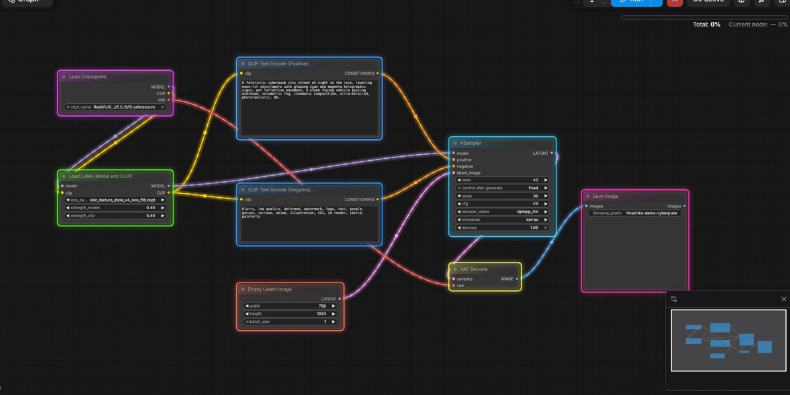
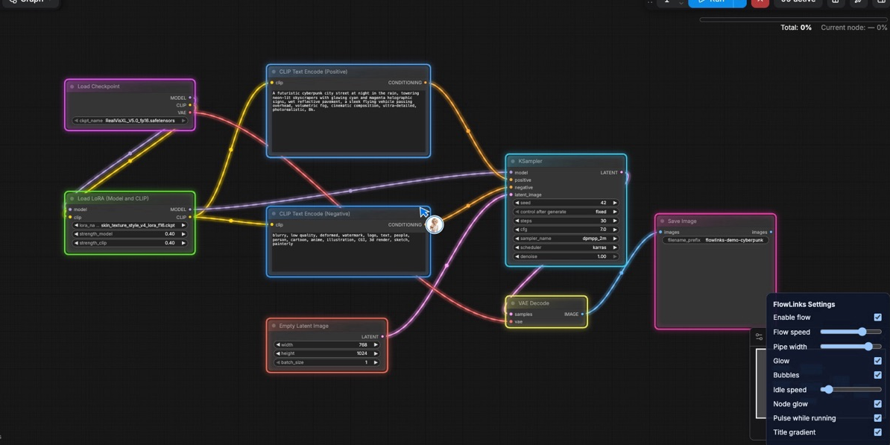

# ComfyUI-FlowLinks

**[English](README.md) | [简体中文](README.zh-CN.md)**

> *为平淡的界面，添一抹流动的色彩。*

[](LICENSE)
[](CHANGELOG.md)
[](https://github.com/comfyanonymous/ComfyUI)

为 ComfyUI 带来**水管流水式动态连线**和**按节点类型配色的荧光边框**。
工作流不再是一张静态的图：正在执行的节点，它的连线流得更快，流速跟着你的
真实生成速度走；跑完的连线渐渐停下，出错的连线变红——你能直接*看见*数据
在工作流里流动。




## 功能特性

- **水管流水连线**——半透明管壁、亮色水段、白色高光虚线，还有随水流走的小气泡。
- **流速跟随执行**——流速实时跟踪前端报告的生成速度（steps/s，来自
  `progress` / `progress_state` 事件）。生成越快，水段越长越亮。
- **状态感知**——活跃连线跑得热，跑完的连线渐停（"数据已送达"），空闲连线
  缓慢漂移，碰到出错节点的连线闪红。
- **按类型配色的节点荧光**——每种节点类型有自己的专属色（对类型名做哈希后
  按黄金角散布），同类节点同色、不同类型互不撞色。执行中的节点呼吸脉冲，
  标题栏带同色渐变。
- **零依赖前端扩展**——纯 JavaScript，没有 Python 节点、没有模型、不用 pip
  安装。它接管的是连线渲染层本身，所以所有节点包都适用。
- **设置面板**——9 项设置（流水开关、流速、管径、辉光、气泡、空闲流速、
  节点荧光、执行脉冲、标题渐变），自动保存到 `localStorage`。面板语言随
  ComfyUI 语言自动切换（English / 简体中文）。

## 安装

### ComfyUI-Manager（推荐）

在 ComfyUI-Manager 里搜索 **FlowLinks**，点 Install，然后重启一次 ComfyUI。

### 手动安装

```bash
cd ComfyUI/custom_nodes
git clone https://github.com/Daroumm/ComfyUI-FlowLinks.git
```

重启 ComfyUI 即可。扩展自动生效——不需要往工作流里加任何节点。

### 用 Release 压缩包

从 Releases 页面下载 `ComfyUI-FlowLinks-v0.1.0-beta.1.zip`，解压到
`ComfyUI/custom_nodes/`，重启 ComfyUI。

**卸载：** 把 `custom_nodes` 里的 `ComfyUI-FlowLinks` 文件夹删掉即可。

## 使用

一切都是自动的。点画布右下角的**「流水」**按钮打开设置面板：

| 设置 | 默认 | 说明 |
|---|---|---|
| 启用流水 | 开 | 连线动画总开关 |
| 流速倍率 | 1.0× | 全局速度倍数（0.2–3.0） |
| 管径 | 7 | 管壁粗细（2–14） |
| 辉光 | 开 | 管壁周围的柔和辉光 |
| 气泡 | 开 | 快速水流里的小气泡 |
| 空闲流速 | 0.12 | 没任务时的漂移速度（0–0.5） |
| 节点荧光 | 开 | 每个节点周围的荧光边框 |
| 执行脉冲 | 开 | 执行中节点的呼吸脉冲 |
| 标题渐变 | 开 | 节点标题栏的同色渐变 |



## 工作原理

FlowLinks 是一个单文件前端扩展（`web/flow_links.js`）：

1. 它包裹 `LitegraphLinkAdapter.renderLinkDirect`，记录每条连线的两端节点，
   并强制打开前端内置的 `flow` 标记。
2. 它把 `CanvasPathRenderer.drawFlowAnimation` 换成水管流水渲染器（管壁＋
   虚线水段＋高光＋气泡），复用渲染器自己的路径和颜色解析。
3. 执行状态来自前端标准事件（`execution_start`、`executing`、`progress`、
   `progress_state`、`execution_success`、`execution_error`、
   `execution_interrupted`）。steps/s 由进度差分算出，并做 EMA 平滑。
4. 节点荧光画在一层叠在画布上方的透明覆盖层上，所以带 DOM 控件的节点
   （Load Image、文本编码器等）也能有边框。覆盖层不可用时回退到包裹
   `LGraphCanvas.drawNode`。
5. 一个 `requestAnimationFrame` 循环（约 30 fps，标签页隐藏时暂停）驱动动画，
   每帧重新读取 `app.canvas`，切换工作流标签页也不会断画。

因为接管发生在连线渲染层，**所有**节点类型都覆盖——官方节点和任何自定义
节点包（GGUF 加载器、姿势工具等）。唯一没有流水的是 Set/Get 无线连接
（没有可见连线）和被禁用的连线（特意跳过）。

## 兼容性

- ComfyUI 前端 ≥ 1.55（在 1.55.18 / ComfyUI 0.45.x 上开发与实测）。
- macOS、Windows、Linux 都适用——扩展是与平台无关的 JavaScript，跑在浏览器里。
  （已在 macOS 实测；Windows/Linux 用同一套前端，理论适用但尚未真机验证——
  欢迎反馈。）
- 超大工作流（100+ 节点）：如果感觉掉帧，在面板里关掉**辉光**或**节点荧光**。

## 已知限制

- 子图内部的节点暂时没有荧光边框。
- Vue 节点渲染模式未单独实测；该模式下连线仍走画布，流水应该正常，欢迎反馈。
- FlowLinks 接管了连线渲染。前端未来大版本升级可能需要跟进适配；最坏情况
  只是流水不显示——你的工作流数据永远不会被改动。

## 常见问题

**它会改我的工作流或生成结果吗？**
不会。FlowLinks 只改变连线和节点边框的画法，从不碰图数据、提示词或生成的图片。

**它会拖慢生成吗？**
不会。渲染在浏览器里以约 30 fps 运行，与后端无关。测试机器上全效开启时
画布仍保持约 60 fps。

**没任务时流水为什么慢？**
空闲连线按*空闲流速*设置漂移（默认 0.12）。想要静止时动得更多，在面板里调高。

**有条连线不流水，为什么？**
被禁用的连线会特意跳过；Set/Get 无线连接没有可见连线可动画。

## 参与贡献

欢迎提 Issue 和 Pull Request。报 bug 时请附上 ComfyUI 版本、前端版本、浏览器，
有截图或录屏更好。

## 许可证

[MIT](LICENSE) © darou
