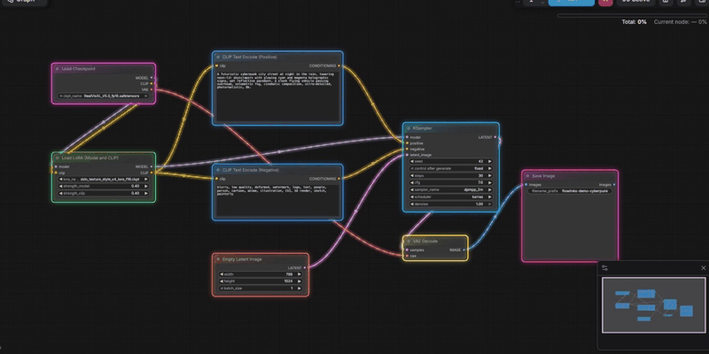

# ComfyUI-FlowLinks

> *为平淡的界面，添一抹流动的色彩。*

让 ComfyUI 的工作流连线像**水管流水**一样动起来，并给每个节点加上**按类型配色的荧光边框**。

- 正在执行的节点，其连线水流加速，流速跟随真实生成速度（steps/s）自动调节；
- 节点跑完，它的输出链路水流渐停；出错的链路变红；
- 每种节点一个专属色相（黄金角散布），同类同色、不同类不撞色；执行中的节点呼吸脉冲，标题栏同色渐变；
- 纯前端扩展，零依赖：不加节点、不装包、不下模型；覆盖所有节点（核心节点和各种自定义节点包都一样）；
- 画布右下角「Flow」按钮打开设置面板（9 项设置，自动保存）。

## 安装

- **ComfyUI-Manager**：搜索 FlowLinks 安装，重启一次 ComfyUI。
- **手动**：把本仓库克隆或解压到 `ComfyUI/custom_nodes/`，重启 ComfyUI。
- **卸载**：删掉 `custom_nodes` 里的文件夹即可。

完整说明（英文）见 [README.md](README.md)。

## 许可证

[MIT](LICENSE) © darou
